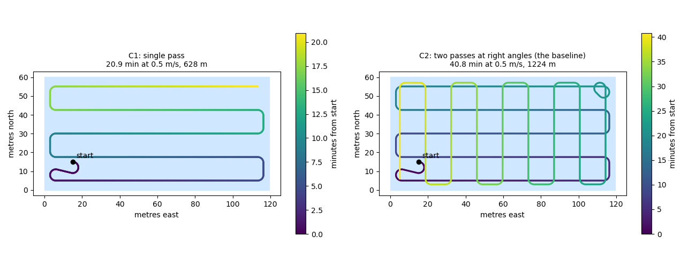
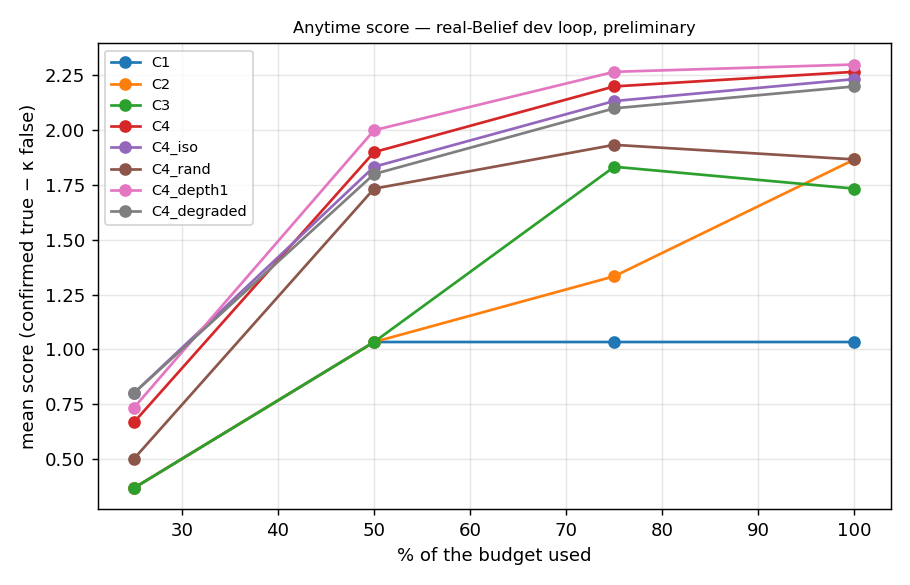

# BlueBoat-Replanner

The aspect-aware replanner of the BlueBoat side-scan sonar survey. During a survey, at each decision
point, it decides whether the boat carries on or goes back to look at a possible target again **from
a chosen direction**, and the boat flies that change in the same run. It also plans every survey type
the project compares, so they all share one coverage generator and one executor.



*Two plans the Replanner generates for the same 120 × 60 m area (blue), coloured by time. Left: C1,
a single pass of parallel lines. Right: C2, the baseline, two passes at right angles. C2 takes about
twice as long; its duration is the time budget every other condition gets. The adaptive conditions
start like these plans and insert revisits during the survey.*

> **Caveats.** The Replanner has **never run on the boat**, and has run in Gazebo once (one C2
> development run). The belief map's scores are not probabilities until a calibrated detector exists,
> so every decision built on them depends on placeholder scores, and every result is
> model-conditional.

## What you can do with it

- **Run a survey in one of seven conditions** (table below) on one mission area, with the same time
  budget for all.
- **Revisit possible targets during the survey** (condition C4), choosing the look direction that adds
  the most information.
- **Compare strategies** in a development loop without ROS, on the belief map's own core, with an
  emulated detector and seeded synthetic worlds.
- **Emulate the detector** in simulation and tests, from a world's true objects.
- **Stop safely**: the planner never starts by itself, and an operator override disarms it.

| Condition | What it does |
|---|---|
| `C1` | Single pass |
| `C2` | Two passes at right angles: **the baseline**, tuned and frozen first (`config/c2_tuned.yaml`) |
| `C3` | C2, with one revisit of each contact after pass 1, at right angles to its first detection (a simple rule) |
| `C4` | Informative: revisits chosen during the survey, with the look direction from an aspect model |
| `C4_iso`, `C4_rand`, `C4_depth1` | Variants of C4 that remove one ingredient: no aspect model; a random look direction; a one-step look-ahead |

## How it connects to the other modules

```
sonar ──► Perception ──► Belief ──BeliefGrid──► [ Replanner ] ──/blueboat/update_path──► Control ──► boat
                                                   ▲   ▲                                     │
                                      mission file ┘   └── path progress, events, odometry ──┘
```

| Module | Link | Relation to the Replanner |
|---|---|---|
| BlueBoat-Belief | [github.com/Kyyrron/BlueBoat-Belief](https://github.com/Kyyrron/BlueBoat-Belief) | Its `BeliefGrid` is the **only** target evidence the Replanner reads |
| BlueBoat-Control | [github.com/Kyyrron/BlueBoat-Control](https://github.com/Kyyrron/BlueBoat-Control) | The live path update `/blueboat/update_path` is the only way the Replanner moves the boat |
| BlueBoat-SSS-Sim | [github.com/Kyyrron/BlueBoat-SSS-Sim](https://github.com/Kyyrron/BlueBoat-SSS-Sim) | Gazebo worlds; start them with `full_mission_launch.py path_source:=replanner` |
| BlueBoat-Perception | [github.com/Kyyrron/BlueBoat-Perception](https://github.com/Kyyrron/BlueBoat-Perception) | The detector, read only through Belief; the emulator stands in for it in tests |
| BlueBoat-MCS | [github.com/Kyyrron/BlueBoat-MCS](https://github.com/Kyyrron/BlueBoat-MCS) | Its geodesy is checked to be identical to the Replanner's |
| Whole project | [github.com/Kyyrron/BlueBoat-SideScanSonar](https://github.com/Kyyrron/BlueBoat-SideScanSonar) | The superproject that holds every module |

The Replanner never reads detections, sonar data or simulation ground truth. A path request that
Control refuses changes nothing.

## Dependencies

| Dependency | Link | Quick install |
|---|---|---|
| Ubuntu 24.04, ROS 2 Jazzy | [docs.ros.org](https://docs.ros.org/en/jazzy/Installation/Ubuntu-Install-Debs.html) | `sudo apt install ros-jazzy-desktop` |
| `blueboat_interfaces` | [BlueBoat-Control](https://github.com/Kyyrron/BlueBoat-Control) | built in the same workspace |
| `blueboat_belief_interfaces` (and `blueboat_belief` for the development loop) | [BlueBoat-Belief](https://github.com/Kyyrron/BlueBoat-Belief) | built in the same workspace |
| numpy, PyYAML | | `sudo apt install python3-numpy python3-yaml` |
| `vision_msgs` (development loop only) | apt | `sudo apt install ros-jazzy-vision-msgs` |

At run time it needs Belief's `belief_map` node and Control's `master_control` (or the simulator).

## Installation, step by step

```bash
# 1. Get the project with its submodules (or clone https://github.com/Kyyrron/BlueBoat-Replanner alone)
mkdir -p ~/ros2_ws/src && cd ~/ros2_ws/src
git clone --recurse-submodules https://github.com/Kyyrron/BlueBoat-SideScanSonar.git

# 2. Build, from a terminal that has NOT activated the venv: the interfaces first
cd ~/ros2_ws && source /opt/ros/jazzy/setup.bash
colcon build --packages-select blueboat_interfaces blueboat_belief_interfaces
colcon build --packages-select blueboat_belief blueboat_replanner

# 3. Every new terminal
cd ~/ros2_ws && source env.sh       # env.sh: "source .venv/bin/activate" + "source install/setup.bash"
```

## Check the installation

```bash
# 1. The offline test gate (no ROS, about 90 s)
cd ~/ros2_ws/src/BlueBoat-SideScanSonar/BlueBoat-Replanner/blueboat_replanner
python3 -B -m test.smoke_test

# 2. The launch file is installed and lists its arguments
cd ~/ros2_ws && source env.sh
ros2 launch blueboat_replanner replanner_launch.py --show-args
```

## Tips: when to use it, what to know

- **Start order**: the simulation or the boat, then Belief, then the Replanner, then arm it with
  `ros2 service call /replanner/start std_srvs/srv/Trigger {}`. It never starts by itself.
- **In Gazebo, start Control in replanner mode** (`path_source:=replanner`): it holds the boat at the
  start until the first path is accepted. Add `use_sim_time:=true time_source:=ros` to the Replanner.
- **An operator override or an emergency stop disarms the Replanner.** Only `/replanner/start`
  re-arms it.
- **"Stop requested" is not "stopped"**: only `/replanner/status` saying `stopped_holding` means the
  boat holds.
- **The mission area must lie inside Belief's survey area**, and the boat must be inside the area
  before `/replanner/start`.
- **The development loop's numbers are preliminary**: an emulated detector, a boat that tracks the
  plan perfectly, placeholder models. Never a thesis result.
- **Compare conditions paired** (same world, seeds and sea), and treat a time difference within
  3 % plus 0.6 s per turn as no difference (superproject `SIM_VALIDITY_CONDITIONS.md`).
- **Do not load the machine while a simulation is being recorded**: check
  `pgrep -af 'record_ru[n]\.py'` before a long development run.



*Development loop only, preliminary: the mean score (targets confirmed minus false confirmations) of
each condition over 30 paired synthetic worlds, as the time budget is used. In this loop the adaptive
conditions lead mid-survey; at the full budget none is clearly better than C2, and the aspect model
shows no effect (C4 equals C4_iso). Details: [docs/DEVLOOP.md](docs/DEVLOOP.md).*

## More documentation

| Document | What you find there |
|---|---|
| [docs/USER_GUIDE.md](docs/USER_GUIDE.md) | Running the node, the mission file, start and stop, the emulator, settings, topics, outputs |
| [docs/DEVELOPMENT.md](docs/DEVELOPMENT.md) | How to work on the Replanner: Claude Code, setup, tests, rules, next steps |
| [docs/HANDOVER.md](docs/HANDOVER.md) | Where the work stands, the owner's decisions, what comes next |
| [docs/REPORT.md](docs/REPORT.md) | What was built, and how much weight each claim carries |
| [docs/DESIGN.md](docs/DESIGN.md) | The design and the scientific background |
| [docs/MATH.md](docs/MATH.md) | The mathematics |
| [docs/topics.md](docs/topics.md) | Every topic, service, JSON schema and file |
| [docs/DEVLOOP.md](docs/DEVLOOP.md) | The development loop: method and results |
| [docs/C2_TUNING_PROTOCOL.md](docs/C2_TUNING_PROTOCOL.md), [docs/C2_TUNING_RESULT.md](docs/C2_TUNING_RESULT.md) | How the baseline was tuned and frozen |
| [docs/LOCAL_CHECKLIST.md](docs/LOCAL_CHECKLIST.md) | Every ROS, Gazebo and boat check, with its command |
| [docs/CONTRACT_CONSUMED.md](docs/CONTRACT_CONSUMED.md), [docs/REAL_BELIEF_BINDING.md](docs/REAL_BELIEF_BINDING.md) | How the belief map is read; how Belief's core is driven offline |
| [docs/EVIDENCE_REGISTER.md](docs/EVIDENCE_REGISTER.md), [docs/REQUESTS.md](docs/REQUESTS.md) | Evidence identifiers; requests to other modules |
| [docs/REPLANNER_BRIEF.md](docs/REPLANNER_BRIEF.md) | The original specification |
